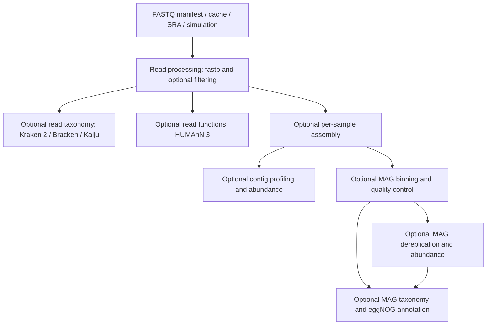

(nf-moshpit)=
# nf-moshpit: the Nextflow workflow

[nf-moshpit](https://github.com/bokulich-lab/nf-moshpit) runs MOSHPIT actions as a Nextflow workflow. Give it reads, choose the analysis steps, and run the same configuration locally or on a Slurm cluster. Nextflow schedules the jobs; Rachis artifacts retain the provenance of each analysis.

**Start here:** follow the [quick start](#nf-moshpit-quick-start) to import paired-end FASTQ files, process them with fastp, and inspect the reports. It needs no reference databases. Add profiling or MAG reconstruction after this first run succeeds.

## Find the guide you need

| I want to… | Read |
| --- | --- |
| Run my first analysis | [Quick start](#nf-moshpit-quick-start) |
| Learn about types of input data | [Inputs](#nf-moshpit-inputs) |
| Choose which steps run and edit a parameter file | [Configuration](#nf-moshpit-configuration) |
| Set read QC, subsampling, host removal, or sample filtering | [Read processing](#nf-moshpit-read-processing) |
| Assemble contigs, reconstruct MAGs, or estimate abundance | [Assembly and MAGs](#nf-moshpit-assembly-mags) |
| Classify sequences or profile functional potential | [Taxonomic and functional profiling](#nf-moshpit-profiling) |
| Prepare and reuse reference databases | [Databases](#nf-moshpit-databases) |
| Learn about runtimes and resource allocation | [Execution](#nf-moshpit-execution) |
| Find artifacts, reports, and caches; resume or archive a run | [Results and resuming](#nf-moshpit-results) |
| Resolve an error | [Troubleshooting](#nf-moshpit-troubleshooting) |
| Check parameter names and defaults | [Configuration](#nf-moshpit-configuration) |

## What the workflow can do

Read QC with fastp always runs. Other branches depend on the settings in your parameter file. Binning requires assembly; dereplication requires binning. Taxonomy and functional annotation can operate on different targets, so a read-based analysis does not need assembly.

The workflow assembles samples individually and can dereplicate MAGs across the resulting collection. It currently starts from reads, rather than from preassembled contigs or existing MAGs. For those starting points, see the [analysis recipes](#workflow-guides).
